# HPA-1198 — painted unit sprites: capture evidence

**Date:** 2026-11-27 · **Build:** branch `claude/project-thread-6zkpe7`, debug `libgrus_godot.so`. City frames and the death crops come from code commit `82c5438`; battle default and attack frames come from the next commit, which adds only the per-unit depth tie-break (a depth-only nudge of at most 0.126 units that removed speckled z-fighting where crowded Brutes overlapped) · **Renderer:** pinned Godot 4.7.1, `--rendering-method gl_compatibility` under Xvfb (software GL, about 4–5 FPS), real game scene with the full HUD.

Every image is a real frame read back from the game viewport. A scratch driver (not committed) steers the camera and issues ordinary bridge commands (`start_match`, `gather`, `place_building`, `reset_benchmark_fixture`); it never pokes gameplay state. Action and death frames are saved from the frame that was actually drawn while the unit showed its action pose, or right after a corpse spawned, so the pixels match the state. Images are JPEG copies of the PNG captures.

Default zoom is camera size 54; max zoom is 24.

## 1920×1080

| What | Frame |
| --- | --- |
| Before vs after, default zoom (crop, 2× magnified). Old 3D Worker about 25 px tall, painted Worker about 38 px. | 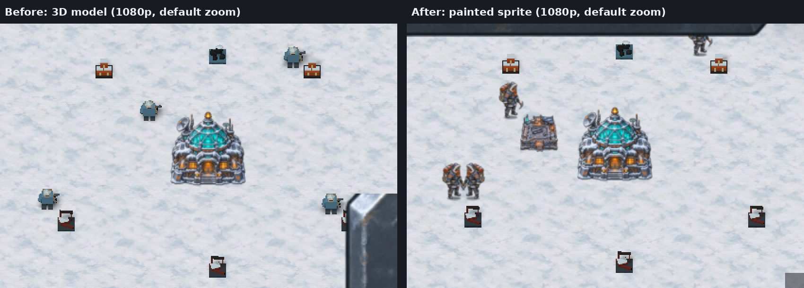 |
| Default zoom, start of a match: three Workers heading to Scrap and Food, one building a Bunkhouse beside the Research Center. | 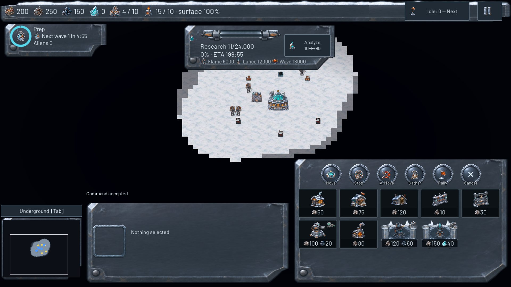 |
| Max zoom, walking: the two Scrap gatherers converge from either side and face their own heading. | 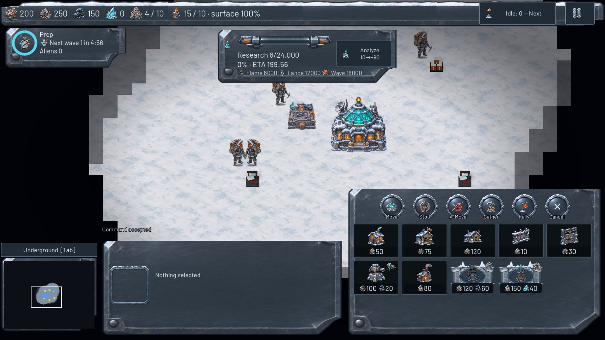 |
| Max zoom, building: the builder in its swing pose, facing the site. | 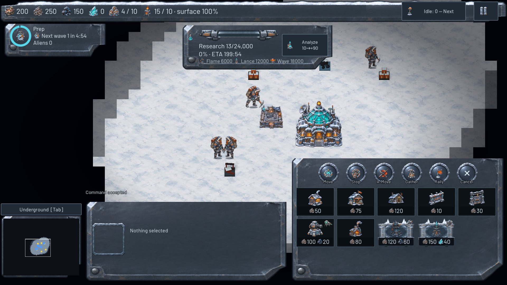 |
| Max zoom, gathering: a gatherer in its swing pose at the Scrap pile. | 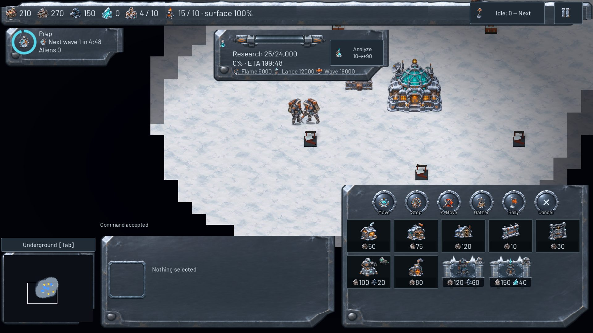 |
| Default zoom, benchmark battle (50 defenders, 150 aliens): walled city, aliens pressing on two sides. | 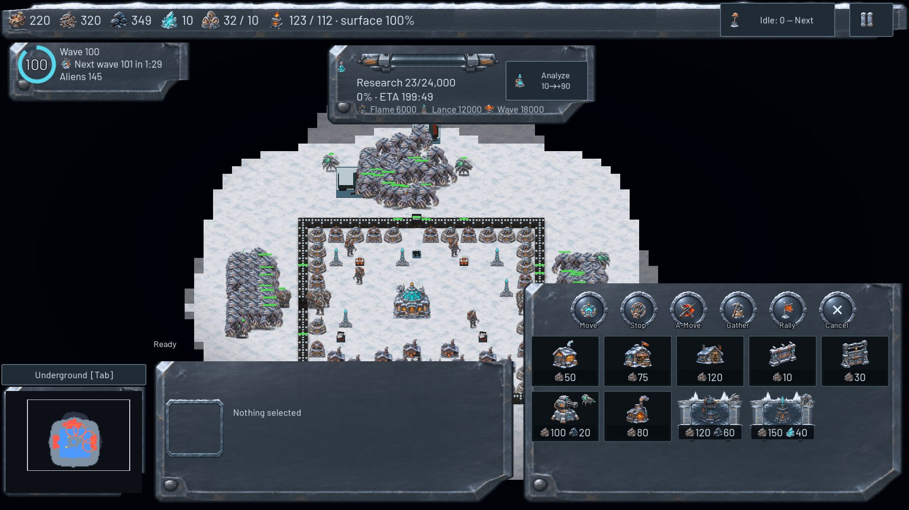 |
| Max zoom, attacking: four selected Riflemen (rings scaled with the kind) firing over the east wall at Brutes, with muzzle flashes from the action pose; captured on a frame where the tracked Rifleman shows its action pose. Guards hold the south side; Spitters approach on the right. | 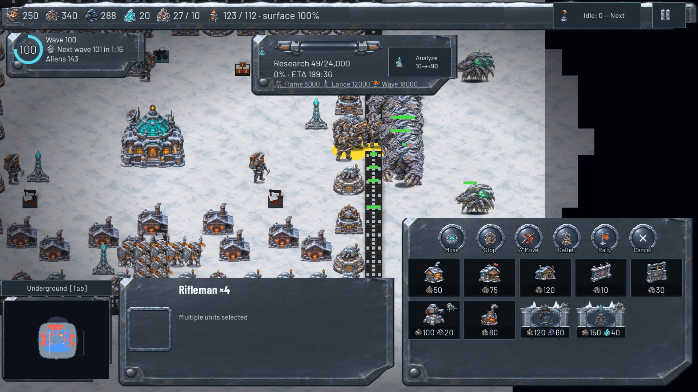 |
| Max zoom, dying (2× crop): the camera jumps to the newest corpse; a Brute has toppled over its feet, tinted, and is starting to fade beside a living Brute and a Spitter. | 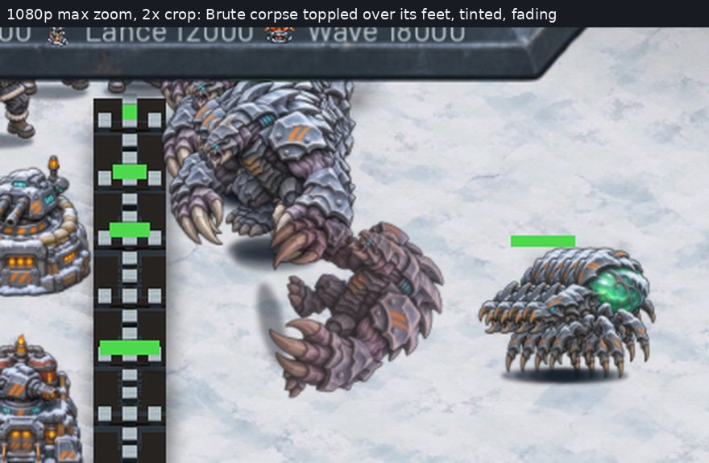 |

## 1280×720

| What | Frame |
| --- | --- |
| Default zoom, start of a match (Worker about 25 px tall). | 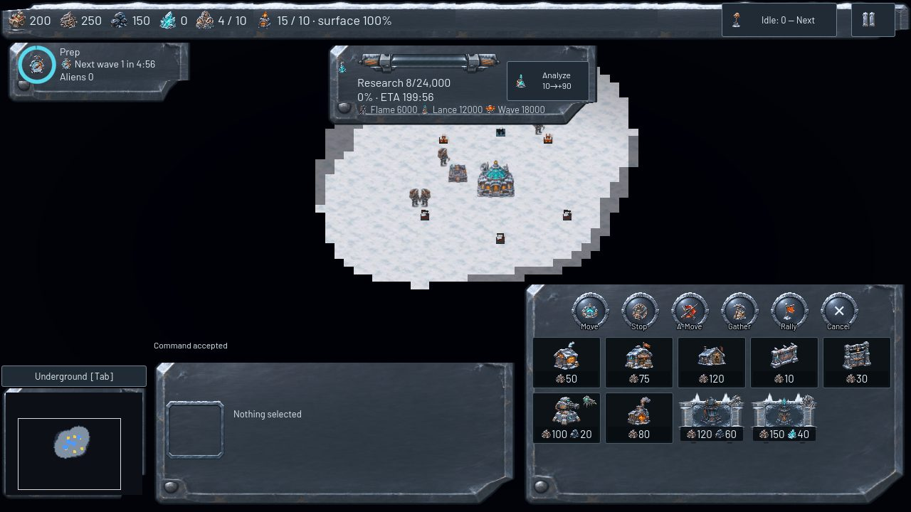 |
| Max zoom, building swing. | 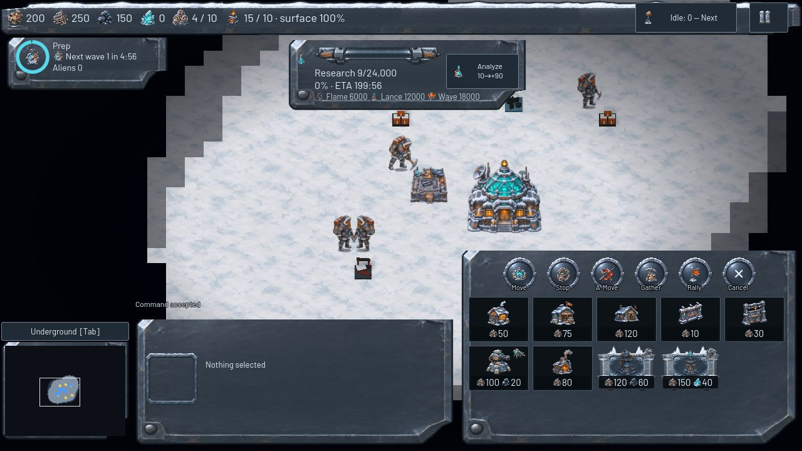 |
| Default zoom, benchmark battle. | 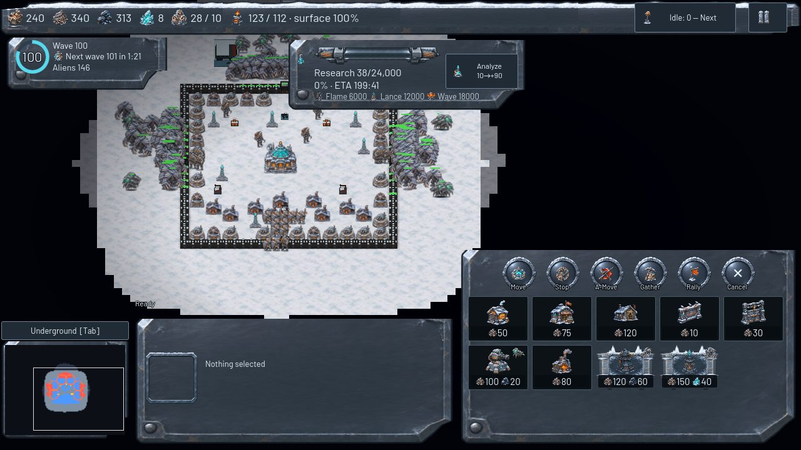 |
| Max zoom, Riflemen firing at the wall. | 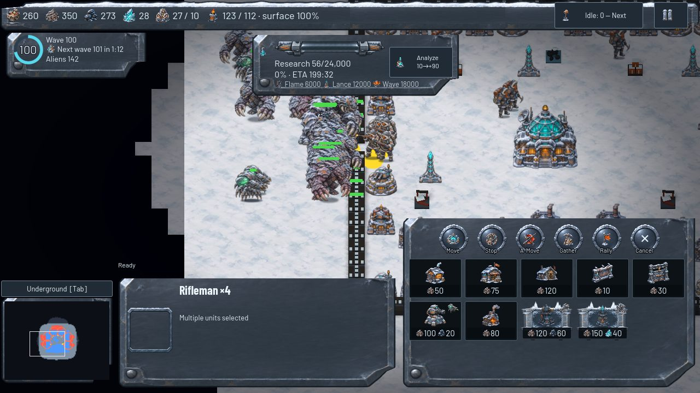 |
| Max zoom, dying (2× crop): a toppled Brute corpse, half faded, at top left. | 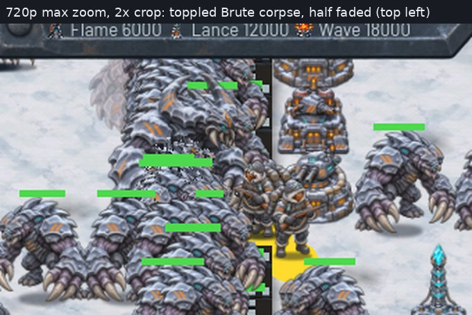 |

## What the smokes assert

The headless smokes cover the same behaviour without screenshots:

- `wave_smoke_test`: all seven kinds render as one painted `Sprite3D` with no meshes, unshaded, depth-tested, billboard off, no shadow, lossless with mipmaps, the per-kind figure height and ring scale; `play_action` shows the action pose and flips toward the target; flipped sprites keep texel-accurate picking; a health drop shows the bar and the hurt tint; a freed unit leaves a toppling corpse with its base pose and facing.
- `combat_lifecycle_smoke_test`: the real wave journey plays attack action poses and spawns at least one corpse.
- `economy_smoke_test`: a real Worker view enters the gather/build swing and plays action poses.
- `smoke_test`: picking a Worker in front of and behind painted buildings, and inside a Gate corridor, still resolves correctly with the larger sprites.

## Limits

- Software GL at 4–5 FPS, so motion is shown as stills; the bob, flip and corpse tweens are timed in real seconds and look smoother at a normal frame rate.
- A later review fix seats each sprite by its feet row (24 px above the canvas bottom, per the art contract) instead of the canvas bottom edge, lowering units by a few pixels (about 2 px for a Worker at 1080p default zoom). These frames predate that fix.
- No owner playtest yet; sizes were judged at 1920×1080 against the old captures.
- The benchmark fixture is dense by design, so Brutes and Behemoths overlap heavily at the wall. The depth tie-break cleared the speckling seen there at 1080p; a small faint patch is still visible in the 720p attack frame where several Brutes overlap. Worth a look in the owner playtest.
