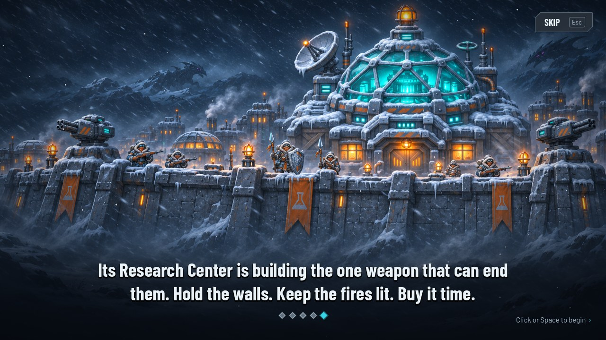
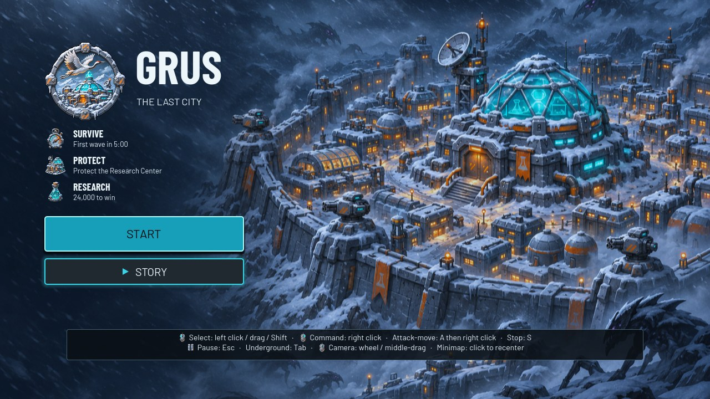
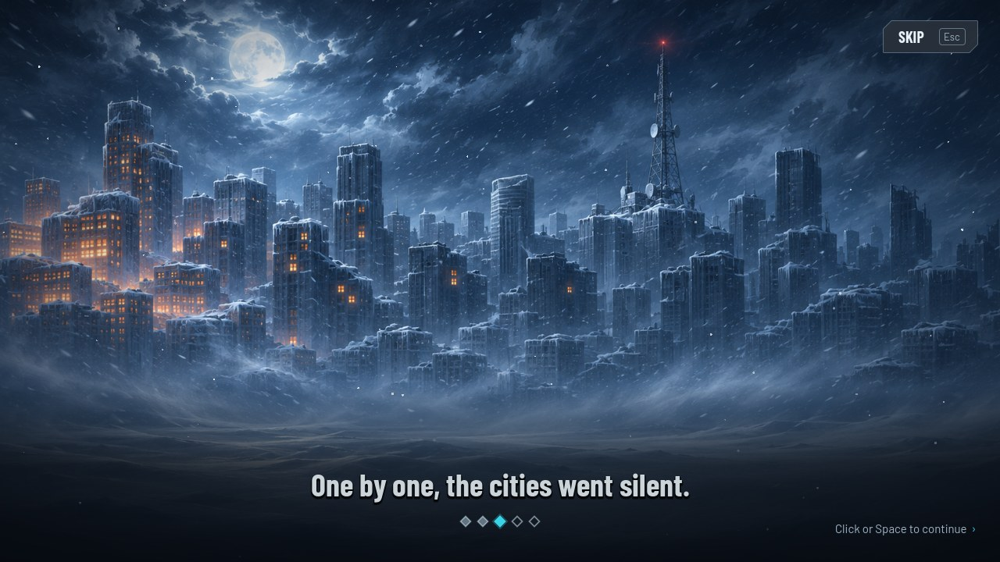

# HPA-1208 — story intro before Start: capture evidence

**Date:** 2026-11-27 · **Renderer:** pinned Godot 4.7.1, `--rendering-method gl_compatibility` under Xvfb (software GL), real game scene with the full HUD, 1280×720.

Every image is a real frame. The panel and STORY frames come from the main smoke's own intro leg with `GRUS_CAPTURE_DIR` set, so they are the frames the real-input journey reaches (STORY click, then click and Space to advance); each panel frame is taken 1.5 s in, once the caption has faded in. The first-launch frame is an X screenshot of the real `main.tscn` launched against a fresh Godot user data folder. Images are JPEG copies of the PNG captures.

## Against the mockup

Left: the approved mockup boards. Right: the game. The mockup's panel art was a stand-in crop of the Start key art; the game shows the painted HPA-1210 panels that have since landed.

## Frames

| What | Frame |
| --- | --- |
| Mid panel (2 of 5): caption, progress diamonds (first done, second lit), SKIP with the Esc key chip, "continue" hint. |  |
| Last panel (5 of 5): the long caption wraps to two lines, every diamond before it is filled, and the hint says "begin". |  |
| Start after the intro, with the new STORY button under START. |  |
| First launch (fresh user folder), about 12 s after boot: the intro played by itself and has moved on to panel 3 on its own. `intro_seen` now exists. |  |

A second launch against the same user folder went straight to Start; its frame was byte-identical to the Start frame above, so it is not repeated. A launch with `BEVY_E2E=1` and a fresh user folder showed Start and wrote no `intro_seen`. The exported debug build (the one the bevy-e2e test runs) also played the intro on its first launch.

## What the smokes assert

`smoke_test` drives the intro on the real Start screen before the match starts: the scene does not auto-play it (the smoke instances `main.tscn` under its own root); STORY sits under START, on screen and clear of the controls strip; STORY opens panel 1 and starts the winter wind loop; Tab does not reach the Underground drawer; click, Space, click, Space walk panels 2 to 5 with the right caption and art (panel 4 is the Start key art) and the "begin" hint only on the last; the last click lands on Start and stops the wind; STORY replays from panel 1 and Esc lands on Start; STORY again and SKIP lands on Start; and no intro click changed the world selection. The other six smokes run unchanged.
