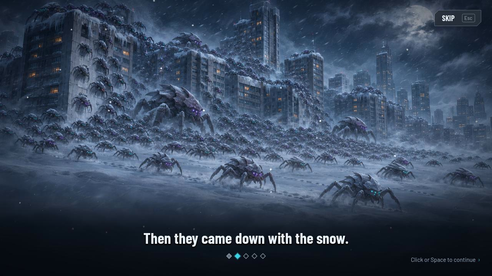
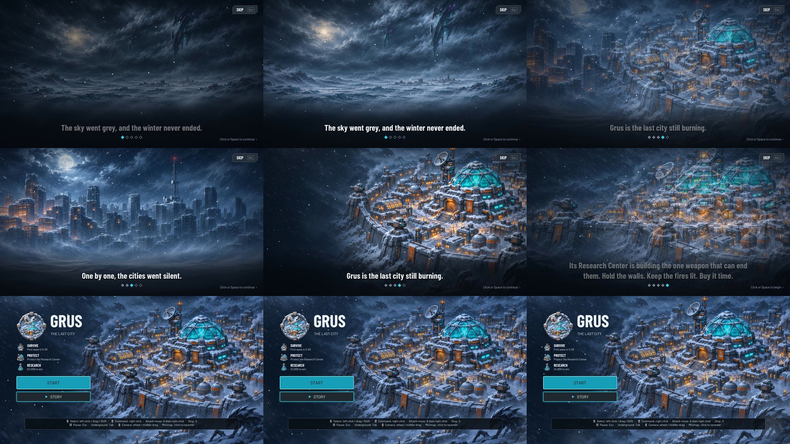
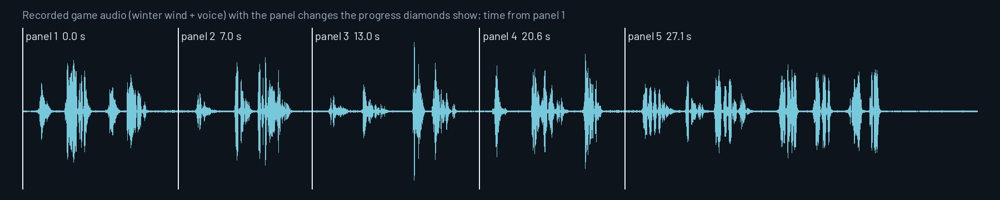

# HPA-1208 — story intro before Start: capture evidence

**Date:** 2026-11-27, background motion and the Japanese voice-over added 2026-11-28 · **Renderer:** pinned Godot 4.7.1, `--rendering-method gl_compatibility` under Xvfb (software GL), real game scene with the full HUD, 1280×720.

Every image is a real frame of the launched game. Since the intro and Start now move, the frames come from Godot Movie Maker recordings (`--write-movie`, `--fixed-fps 30`, 1280×720) of `main.tscn` against a fresh Godot user data folder: the first launch plays the intro by itself (43 s recorded, with the voice-over), and a second launch against the same folder goes straight to Start (13 s recorded). Panel frames are taken 2 s into the panel, once the crossfade and caption have finished. Images are JPEG copies of the PNG frames.

## Against the mockup

Left: the approved mockup boards. Right: the game. The mockup's panel art was a stand-in crop of the Start key art; the game shows the painted HPA-1210 panels that have since landed.

## Frames

| What | Frame |
| --- | --- |
| Mid panel (2 of 5): caption, progress diamonds (first done, second lit), SKIP with the Esc key chip, "continue" hint. |  |
| Last panel (5 of 5): the long caption wraps to two lines, every diamond before it is filled, and the hint says "begin". |  |
| Start after the intro, with the new STORY button under START. |  |
| First launch (fresh user folder), 15 s after boot: the intro played by itself and has moved on to panel 3 on its own. `intro_seen` now exists. |  |

A second launch against the same user folder went straight to Start (the Start frame above comes from that launch). A launch with `BEVY_E2E=1` and a fresh user folder showed Start and wrote no `intro_seen`. The exported debug build (the one the bevy-e2e test runs) also played the intro on its first launch.

## Motion

Nine frames from the same recordings, read left to right. Row 1: panel 1 fading in from black at 0.5 s, the same panel at 6.6 s after its push in, and the 1-second crossfade into panel 4 at 21.1 s (panel 3's city still showing through). Row 2: panel 3 at 15 s, panel 4 at 25 s (the key art's own dark left side, now pushed in), and the crossfade into panel 5 at 27.6 s. Row 3: Start at 1 s, 6 s and 12 s; the key art pushes in slowly over 20 s and glides back, under the same snow and fog. Each panel drifts from 1.04× to 1.16× zoom with a 3.5% pan that alternates left and right; Start drifts from 1.02× to 1.10× with a 2.5% pan. Snow is two seeded layers (110 small, slow, faint far flakes and 36 large, fast, bright near flakes that drift further sideways); the fog is a low band of scrolling noise in a shader. All of it runs on unscaled process time, so the smokes' raised `Engine.time_scale` does not speed it up.

## Voice-over

Each panel plays one Japanese line by the ElevenLabs voice "ryo kazuma" (`godot/assets/audio/voice/intro_ja/`, provenance in `godot/assets/audio/README.md`); the captions stay English until the game is localised. A line starts 0.5 s into its panel, as the crossfade passes halfway, and panels 1 to 4 hold for 7, 6, 7.5 and 6.5 s so each line ends before the next panel; the last panel waits. A click, Space or Enter moves on early and cuts the line, and closing the intro silences it.

Below is the recorded game audio of the first-launch recording (winter wind plus voice), against the panel changes read from the lit progress diamond in the same frames. Each line sits inside its own panel and ends before the next one starts. The lines were levelled to -21 LUFS so no panel is louder than the others.

## What the smokes assert

`smoke_test` drives the intro on the real Start screen before the match starts: the scene does not auto-play it (the smoke instances `main.tscn` under its own root); STORY sits under START, on screen and clear of the controls strip; STORY opens panel 1 and starts the winter wind loop; Tab does not reach the Underground drawer; click, Space, click, Space walk panels 2 to 5 with the right caption and art (panel 4 is the Start key art) and the "begin" hint only on the last; each panel holds its own voice line and plays it; the last click lands on Start and stops the wind and the voice; STORY replays from panel 1 and Esc lands on Start; STORY again and SKIP lands on a silent Start; `Space` on Start then does not replay the intro, because STORY holds no keyboard focus; the Start key art is drifting (zoomed past 1× and changing over half a second) under a visible snow and fog layer that ignores the mouse; and no intro click changed the world selection. The other six smokes run unchanged.
