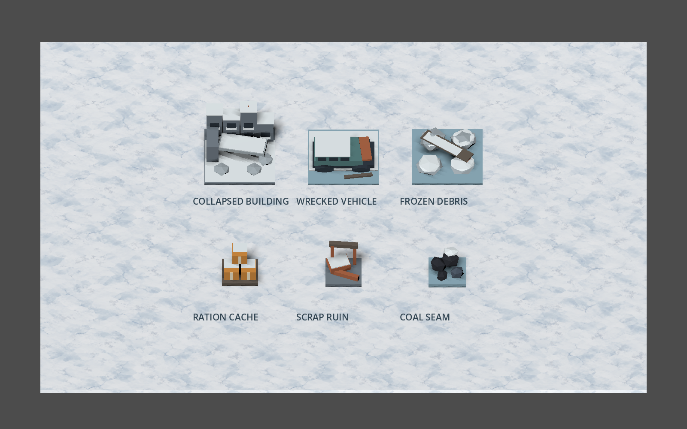
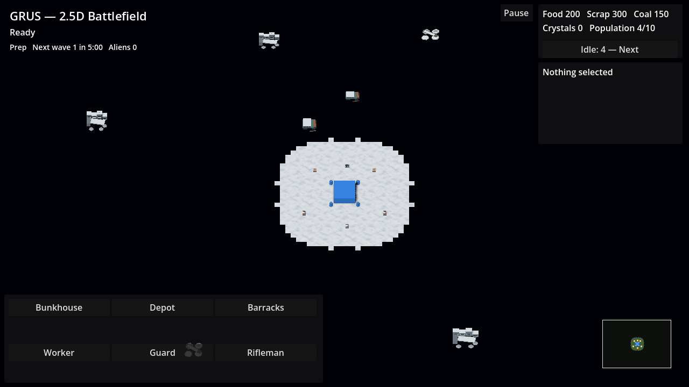

# HPA-290 winter-city art verification

Local verification on 2026-10-28, macOS / Apple M1 Pro, Godot 4.7.1 (`gl_compatibility`), Rust 1.95.0 and Blender 5.2.1 LTS. Base `ba5429b`. No simulation or bridge source changes.

## Delivered

- Textured, mipmapped snow ground over the existing 128×96 battlefield.
- Six self-contained low-poly GLBs: collapsed building, wrecked transport, frozen debris, ration cache, scrap ruin and coal seam.
- Bridge-derived obstacle placements, one imported prop per rectangle; no copied layout coordinates or added collision/navigation.
- Existing resource roots still own IDs, visibility, picking and depletion. Materials are shared without per-instance mutation.
- [Asset provenance and regeneration](../godot/assets/winter/README.md).

## Checks

| Check | Result |
| --- | --- |
| `cargo build -p grus-godot --locked`, copied current library to `godot/bin` | Passed |
| `cargo test --workspace --locked` | 244 tests passed across 8 suites |
| Fresh Godot editor import with the generated `.godot` cache moved aside | Passed; no warnings/errors |
| Reimport after final resource sizing | Passed; no warnings/errors |
| `res://scenes/smoke_test.tscn` | `GRUS_GODOT_SMOKE_OK`, max visual step 0.126; imported bounds and maximum-zoom picking checked |
| `res://scenes/reset_test.tscn` | `GRUS_RESET_SMOKE_OK`, fixture 4/1/18 and starting stockpile/fog preserved |
| `res://scenes/economy_smoke_test.tscn` | `GRUS_ECONOMY_SMOKE_OK`, real UI gather/build/train/rally flow |
| `res://scenes/combat_lifecycle_smoke_test.tscn` | `GRUS_COMBAT_LIFECYCLE_SMOKE_OK`, Crystal reward, pause, Defeat, restart |
| `res://scenes/wave_smoke_test.tscn` | `GRUS_WAVE_SMOKE_OK`, warning, anchor pings, fog and role silhouettes |
| Blender exporter self-checks | All six assets passed bounds and triangle budgets, 84–396 triangles each |
| `git diff --check` | Passed |

All five final smokes ran sequentially, exited 0, emitted their success marker and reported no errors or warnings. An earlier run overlapped the main timing-sensitive smoke with rendered capture and failed interpolation (`max_step=0.552`); isolated runs passed at 0.052 and 0.059 before the picking correction, and the final complete run passed at 0.126. Render capture runs separately from gameplay smokes.

## Regressions caught and fixed

The new geometry check first failed on placeholder boxes. It subsequently caught Godot's `_vehicle` node-name hint turning the wreck mesh into a falling physics vehicle; the exported node is now `wrecked_transport`, with a static-art physics-body guard in the smoke.

One fresh independent whole-change reviewer found raised resource geometry outside the existing 20-pixel click radius at maximum zoom. A new smoke checks gathering picks at every projected vertex of the visible resource meshes with the camera at its allowed minimum size, in the 1280×720 game viewport. It failed on the original Food model, then passed after exporting resource geometry at 75% size. The complete five-smoke suite passed after that correction. No other actionable defects were reported. Art direction and hardware performance were outside that review's judgment; no hardware performance acceptance is claimed here.

## Rendered inspection

Both captures use the actual Godot-imported GLBs and ground material, with the game's fixed-angle orthographic view. The asset sheet enlarges props for inspection; the battlefield image uses the native 1280×720 game viewport after Start, with normal fog. Static ruins retain their existing visibility above the flat fog layer; they are authored map terrain, not hidden enemy entities. Capture exited 0 without engine warnings/errors.

## Limits

Linux export, exported-build e2e, hosted CI and reference-hardware performance acceptance were not run. This is local art integration and gameplay-smoke evidence. Nothing has been pushed or merged.
