# HPA-291 frozen-city structure models — verification evidence

Local verification on 2026-11-07, macOS / Apple M1 Pro (macOS 26), Godot
4.7.1.stable.official (`gl_compatibility`, OpenGL 4.1 Metal), Rust 1.95.0
(`aarch64-apple-darwin`, the only installed target) and Blender 5.2.1 LTS at
`/Applications/Blender.app/Contents/MacOS/Blender`. Branch
`hpa-291-structure-models`, evidence captured at commits
`3ce8fc2`–`86ccca8`. No
`crates/grus-sim` or gameplay change exists on this branch (`git diff
main...HEAD -- crates/grus-sim` is empty); the only
`crates/grus-godot/src/lib.rs` delta is the permitted view-projection
(`update_cold_tints` → `update_building_view_states`,
`set_view_cold` → `set_view_state(complete, cold)`).

## Checks actually run (all exit 0)

| Check | Command | Result |
| --- | --- | --- |
| Build + stage + sign | `cargo build -p grus-godot --locked --offline`, `cp target/debug/libgrus_godot.dylib godot/bin/`, `codesign --force --sign - godot/bin/libgrus_godot.dylib` | Passed; `codesign -v` clean. Fresh binary staged before every run below. |
| Fresh editor import | `godot --headless --path godot --editor --quit-after 120` with `godot/.godot` deleted first | Exit 0; 313-line log contains zero WARNING/ERROR lines; all 11 structure GLBs and 6 winter GLBs reimported; `.godot` cache regenerated. |
| Blender regeneration | `blender --background --factory-startup --python-exit-code 1 --python scripts/build_winter_assets.py` (absolute app-bundle binary; `blender` is not on PATH here) | Exit 0; 17 `WINTER_ASSET_OK` lines; only two `DeprecationWarning` Python notices about `Material.use_nodes` (Blender 6.0 deprecation, unrelated to export); **zero GLB image warnings**. SHA-256 of all 11 structure GLBs + `structure_albedo.png` + all 6 winter GLBs + `snow_albedo.png` byte-identical to committed outputs (`shasum -a 256 -c`: 19/19 OK); `git status` clean afterwards. |
| `res://scenes/smoke_test.tscn` | `godot --headless --path godot` | `GRUS_GODOT_SMOKE_OK units=4 ... structures=catalogue_hookup gate_corridor=clear wall_gate=edge_contact wall_gate_run=edge_contact push_contract=cached_once silhouette_pick=roof_triangle_rc healthbar_px=excluded interpolation=max_step_0.118`; also prints `SMOKE_STRUCTURE_AUDIT source_bytes=editor` (raw-GLB and building_view.gd source audits run under the editor binary) |
| `res://scenes/reset_test.tscn` | same | `GRUS_RESET_SMOKE_OK units=4 buildings=1 resources=18 stockpile=200/300/150/0 population=4/10 fog=128x96 pre_wave=true heat=15/10/100%` |
| `res://scenes/economy_smoke_test.tscn` | same | `GRUS_ECONOMY_SMOKE_OK bunkhouse_model=site_to_glb overlays=cold_warm_recovery zero_demand=wall_gate_furnace bounds=catalogue_grounded ... elapsed_ms=24661` |
| `res://scenes/combat_lifecycle_smoke_test.tscn` | same | `GRUS_COMBAT_LIFECYCLE_SMOKE_OK stage=restart-fresh ... research_boundary=analyze_reject8_zero_crystal` |
| `res://scenes/wave_smoke_test.tscn` | same | `GRUS_WAVE_SMOKE_OK start_pause_clock_frozen=true warning_hud=true snapshot_anchor_pings=true fog_markers_gated=true role_probes=white_box journey=kill_crystal_defeat_restart` |
| `res://scenes/defenses_smoke_test.tscn` | same | `GRUS_DEFENSE_SMOKE_OK wall_ring=28 ... turret_tracer_origin=building_view defense_models=catalogue_glb_grounded setup_s=16.3 post_wave_s=17.6` |
| `res://scenes/underground_smoke_test.tscn` | same | `GRUS_UNDERGROUND_SMOKE_OK gathered_scrap=740 gathered_coal=110 paid_scrap=1026 paid_coal=258 cold_rate=2.8750 heat_delta=15 margin_s=40.00 elapsed_ms=13706` |
| Packaged smoke-entry context | `godot --headless --path <scratch copy> --export-pack "Linux x86_64" <pck>` under the project's own preset, then the official 4.7.1 `godot_macos_debug` template binary run headless against the side-car `.pck` with `bin/libgrus_godot.dylib` beside it — the layout CI's export step produces | Exit 0; `SMOKE_STRUCTURE_AUDIT source_bytes=skipped_packaged` then the full `GRUS_GODOT_SMOKE_OK` contract (input/selection/move/cadence, fog scout leg, `structures=catalogue_hookup`, gate corridor/contact/run, push contract). The PCK carries the same `res://.godot/imported/*.scn` remaps and compiled `.gdc` scripts a Linux export produces. Pre-fix this exact setup reproduced the CI failure (`res://assets/structures/research_center.glb is not a binary glTF`, exit 1). Recorded in the follow-up fix commit `86ccca8`; Linux CI remains the gate for the real Linux binary — run `42367529198` on `86ccca8` has since passed it (CI section below). |
| fmt | `cargo fmt --all -- --check` | Exit 0 |
| Clippy workspace | `cargo clippy --workspace --all-targets --locked --offline -- -D warnings` | Exit 0 |
| Clippy e2e feature | `cargo clippy -p grus-godot --all-targets --features e2e --locked --offline -- -D warnings` | Exit 0 |
| Workspace tests | `cargo test --workspace --locked --offline` | Exit 0: 370 grus-sim + 37 grus-godot lib + 16 system_order + 6 cross-suite + e2e_boot skip-loudly (no `GRUS_E2E_BINARY`); survival_balance 3 passed/1 release-ignored |
| e2e lib tests (serialized) | `cargo test -p grus-godot --lib --features e2e --locked --offline -- --test-threads=1` | Exit 0, 40 passed |
| 90% coverage gate | `cargo llvm-cov -p grus-sim --all-targets --fail-under-lines 90 --locked --offline --ignore-filename-regex 'tests\.rs$'` | Exit 0; **96.50% lines** (4916 lines, 172 missed), TOTAL regions 95.95% |
| Survival balance | `cargo test -p grus-sim --release --locked --offline --test survival_balance -- --ignored --nocapture` | Exit 0; `fixed_defense_survives_wave_10_and_falls_before_wave_40`: defeat during wave 11 at 1383.75 simulated s, 9.07 s wall-clock |
| Rendered 200-unit benchmark | `godot --path godot res://scenes/benchmark_200.tscn` (windowed, real Metal renderer, `GRUS_BENCHMARK_SECONDS` default 10) | Exit 0; `GRUS_BENCHMARK_200 start_units=200 human_units=50 alien_units=150 min_live=180 mean_live=185.8 end=180 visible_in_tree mean=152.7 duration_s=18.60 frames=135 mean_ms=137.8 p50_ms=50.7 p95_ms=122.2 p99_ms=1178.6 max_ms=9632.1 visibility_revision=205 end_buildings=146 kinds=CoalFurnace:9,CrystalLance:6,FlameTower:10,Gate:4,GunTurret:24,ResearchCenter:1,Wall:92 heat=123/112 eff=1.000 coal=350 adapter="Apple M1 Pro"`. Debug-extension local numbers only — not the Linux reference host. |

All seven smokes ran sequentially under a bounded watchdog, each exiting 0
with its marker. **No log contained any warning, error, or leak line** in
this run — including the intermittent `ObjectDB instances were leaked`
teardown warning the baseline recorded for `defenses_smoke_test`, which did
not reproduce here.

## Not run — genuinely blocked on this host

- **Linux x86_64 export and packaged bevy-e2e** (`scripts/package_linux_x86_64.sh`,
  `GRUS_E2E_BINARY`): only the `aarch64-apple-darwin` Rust target is
  installed, the script needs `target/release/libgrus_godot.so` built on a
  Linux host, the Docker daemon is not running (`docker info` connection
  refused), and a Linux x86_64 binary cannot execute natively on this Mac.
  Godot 4.7.1 Linux export templates are installed, but no local path can
  produce or run the Linux GDExtension. The `e2e_boot` test therefore
  skipped loudly as designed. CI (Linux jobs) remains the gate for
  these, as with previous tickets — run `42367529198` on `86ccca8`
  passed the Linux export, exported-smoke and packaged bevy-e2e legs
  (CI section below). Note the packaged *smoke* context itself is no
  longer unverifiable locally: the export-pack + macOS-template row above
  exercises the same PCK remaps the Linux packaged smoke runs against.
- No toolchain or config was changed to work around the above.

## GitHub CI (Linux reference host)

Recorded 2026-11-07 from the GitHub MCP. Two runs on this branch,
distinguished by exact head commit:

- Run
  [`42364893406`](https://github.com/cwchanap/Grus/actions/runs/42364893406)
  on `b65ef28` — every source gate passed, but the exported smoke-entry
  binary exited 1 on `res://assets/structures/research_center.glb is not
  a binary glTF`: in an export, FileAccess on the `.glb` path reads a
  remapped imported PackedScene inside the PCK, so the original bytes
  are absent. Commit `86ccca8` corrected those source-only checks; the
  local packaged-PCK RED/GREEN proof is the table row above.
- Run
  [`42367529198`](https://github.com/cwchanap/Grus/actions/runs/42367529198)
  on `86ccca86442ef95303ff1c3263ff832f56175ff7` (`86ccca8`) completed
  successfully: check runs `rust-build-lint`, `unit-tests`,
  `survival-balance`, `codecov/patch` and `e2e` all passed. The e2e job
  ([`128389684421`](https://github.com/cwchanap/Grus/actions/runs/42367529198/job/128389684421))
  ran the real Linux x86_64 export, passed the exported bridge smoke
  contract — the exact leg that failed on `b65ef28` — rendered the
  200-unit benchmark at 1080p on the Linux host and packaged bevy-e2e:
  the legs the section above records as impossible on this Mac.

These results cover `86ccca8` only; this docs-only evidence update had
not itself been through CI when written. Every number in the checks
table remains a local macOS measurement — Linux CI status is recorded
only in this section.

## Rendered evidence — real 1280×720 frames

Captured on the live game (`godot --path godot`, Metal/GL renderer, real
`main.tscn` + autoloads) by a throwaway capture scene that only issued real
`GrusBridge` commands (`start_match`, `set_sim_speed(20)`, `gather`,
`place_building`, `placement_preview`) and read snapshots — the same
commands the HUD buttons produce. The script was deleted after the run;
each PNG was asserted 1280×720 at capture. Orthographic camera framing was
set on the live `Camera3D` only (position/size; no state change), followed
by `reset_physics_interpolation()` (the project runs with
`common/physics_interpolation=true`, which otherwise lerps ortho `size`
across a physics tick and can leak a mid-transition frame into the viewport
readback). Every saved frame was verified in-script before saving: the two
authored food sources at cells (58,42)/(69,42) had to render at their
`unproject_position` pixels, so each PNG provably shows its labelled
framing rather than a stale or interpolated frame (log:
`SHOT_SAVED <name> marks=verified` for all 11 frames; per-frame
`SHOT_META` lines record `camera_size`, projected world height and camera
position). All frames were taken while the session was **Playing**, so no
pause/session overlay obscures them; the HUD itself is intentionally
visible as provenance. Workers gathered the required Scrap through real
gather cycles; buildings were placed and completed through the real
construction path before wave 1 (which never launched during capture; the
run finished at ~2:30 remaining on the prep clock with `Aliens 0`).

| Frame | What it shows |
| --- | --- |
| `hpa-291-construction-in-progress.png` | City mid-construction at size 24 — the gameplay minimum zoom (`MIN_CAMERA_SIZE`): the Barracks still building (site state, snapshot progress>0) beside the completed Research Center; north Wall/Gate sites and Bunkhouse/Depot/GunTurret sites carry scaffold rails + orange work lights; HUD `Population 4/10`, `heat 15/10 surface 100%`, wave prep 3:56. |
| `hpa-291-construction-in-progress-detail.png` | Supplemental close-up of the same moment at size 20 — below the gameplay minimum zoom and therefore not reachable in play; kept only to make the construction-site mesh details (railings, glowing interior) legible. |
| `hpa-291-city-cold-deficit.png` | Completed deficit city at size 45: `heat 15/17 · surface 88%` — every completed heat-demanding structure (RC, Barracks, Bunkhouse, Depot, GunTurret) carries the shared pale ice `material_overlay`; zero-demand Wall/Gate stays un-iced. |
| `hpa-291-city-cold-deficit-detail.png` | Same deficit at size 24 (the game's minimum zoom): frosted, washed palettes vs. authored colors; HUD `surface 88%`. |
| `hpa-291-city-complete-warm.png` | Completed city after Coal-Furnace recovery at the same size-45 framing: `heat 27/17 · surface 100%`; all structures warm — authored palettes, RC cyan mast, Barracks parapet, turret shield, CoalFurnace dark body with orange vent. |
| `hpa-291-city-warm-recovery-detail.png` | Same size-24 detail as the deficit frame: overlay cleared, the completed CoalFurnace (bottom-left, orange heat vent) restored supply. Direct cold↔warm comparison pair. |
| `hpa-291-wall-gate-wall-horizontal.png` | Wall–Gate–Wall along X at (59–63, 44) at size 24: continuous crenellated band, gate portal centered, no seam gap; Barracks, RC, GunTurret and both runs visible in context. |
| `hpa-291-wall-gate-wall-horizontal-detail.png` | Same run at size 14 (below the gameplay min zoom, for seam assessment only): gate posts meet wall corner blocks, elevated band continuous. |
| `hpa-291-wall-gate-wall-vertical.png` | Wall–Gate–Wall along Z at (70, 47–49) at size 24: vertical run reads identically — the tiles are four-side compatible with no rotation. |
| `hpa-291-wall-gate-wall-vertical-detail.png` | Same vertical run at size 14. |
| `hpa-291-city-wide-context.png` | Whole-map context at the default gameplay zoom (size 72): revealed fog circle around the city, authored ruins and expansion resources still unexplored, minimap populated. |

Deficit ledger proven by the same run's snapshots/log: supply 15 / demand
17 → `surface_efficiency` 0.882 (all heat-demanding Team-1 buildings iced,
Walls/Gates exempt); completed CoalFurnace → supply 27 → 1.000 and warm.

### Observed issues / notes (honest)

- The ice overlay is intentionally subtle (40%-alpha pale blue); at size 45
  it reads as a light frost, at size 24 it is clearly distinguishable.
  Evidence relies on the detail pair, not just the wide frames.
- The build-grid HUD occupies the lower-left of the size-24/14 frames; it
  does not occlude any assessed structure. HUD presence is deliberate
  provenance that these are live game frames.
- `hpa-291-construction-in-progress.png` is the construction record at the
  gameplay minimum zoom (size 24): fast walls already complete, Barracks
  mid-progress — the construction-site model is most legible at the
  Barracks footprint, and sites are distinguishable from finished models
  mainly by their low dark slab/scaffold silhouette plus orange work
  lights. `hpa-291-construction-in-progress-detail.png` repeats the moment
  at size 20 — a supplemental zoom below what gameplay permits, retained
  purely for mesh-detail legibility.
- `benchmark_200` frame times (mean 137.8 ms, max 9.6 s on one frame) are a
  debug-GDExtension macOS measurement under a 200-unit siege — a contract
  result, not a hardware-acceptance number.
- Static ruins read through fog (authored terrain, expected), and two
  workers stand on the north wall row's approach cells in the deficit
  frames — pathing to a gather source, not a wall collision.

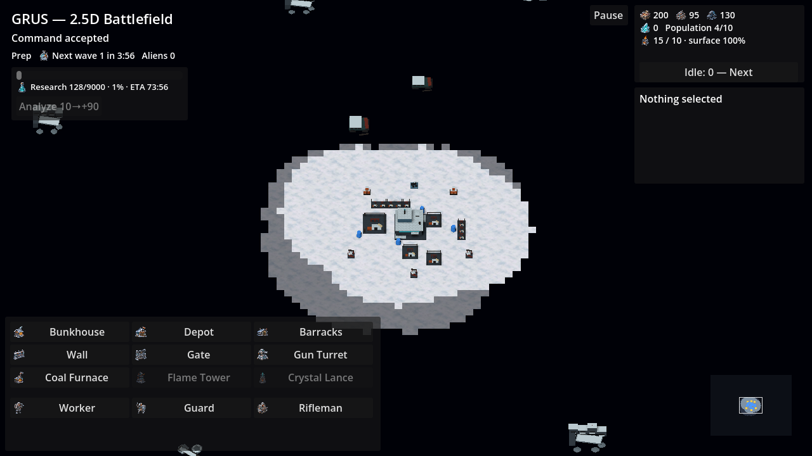
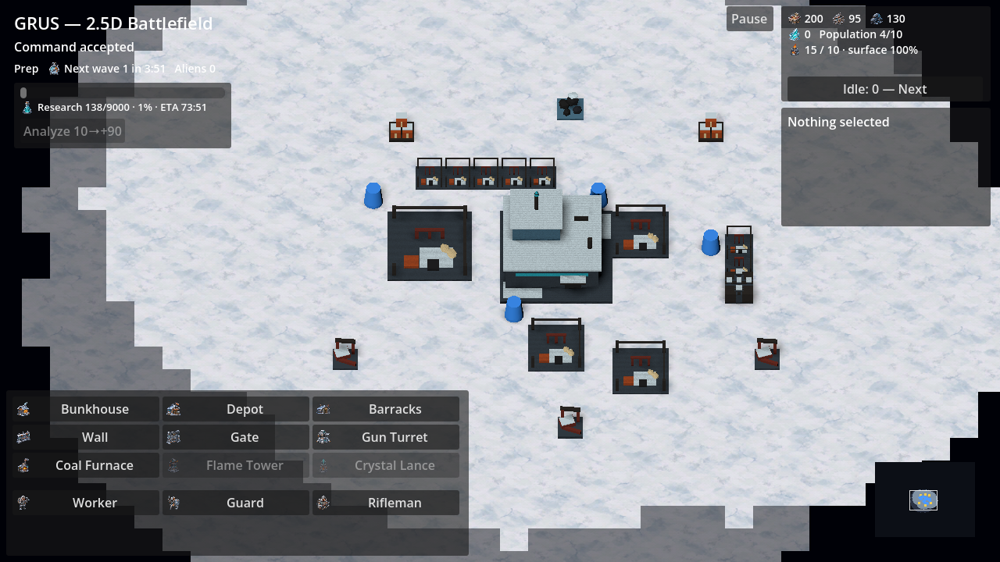
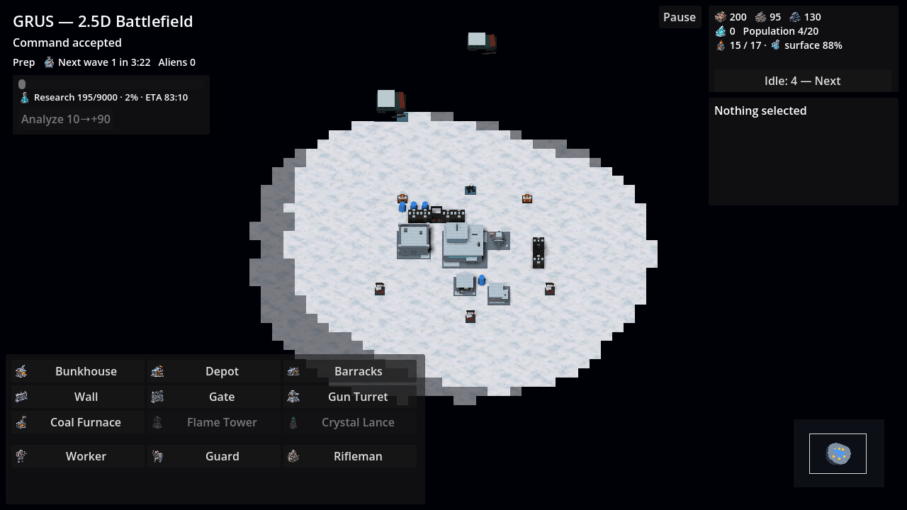
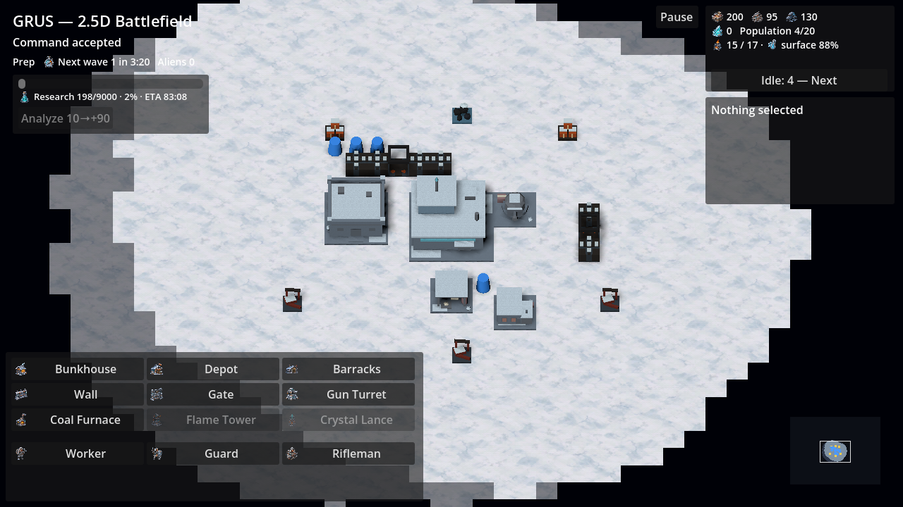
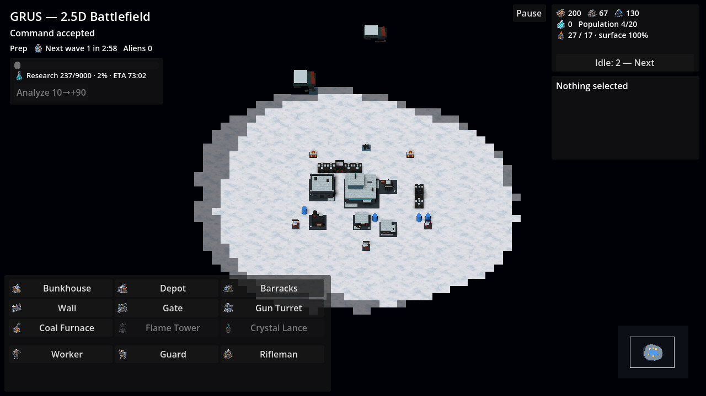
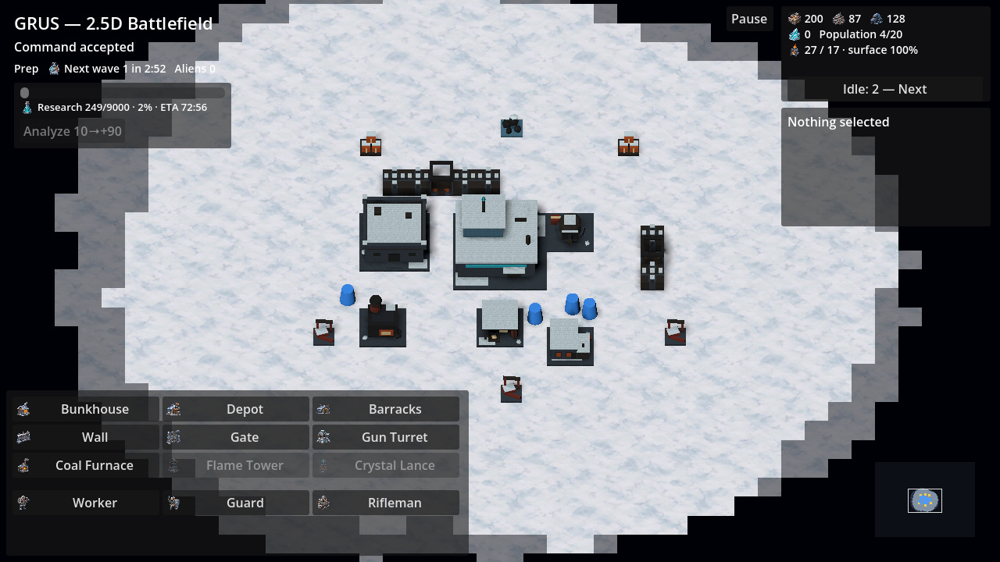
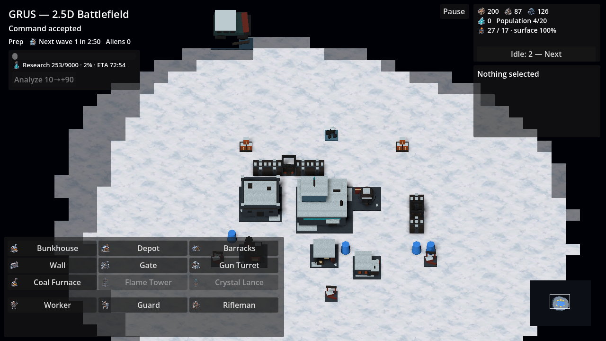
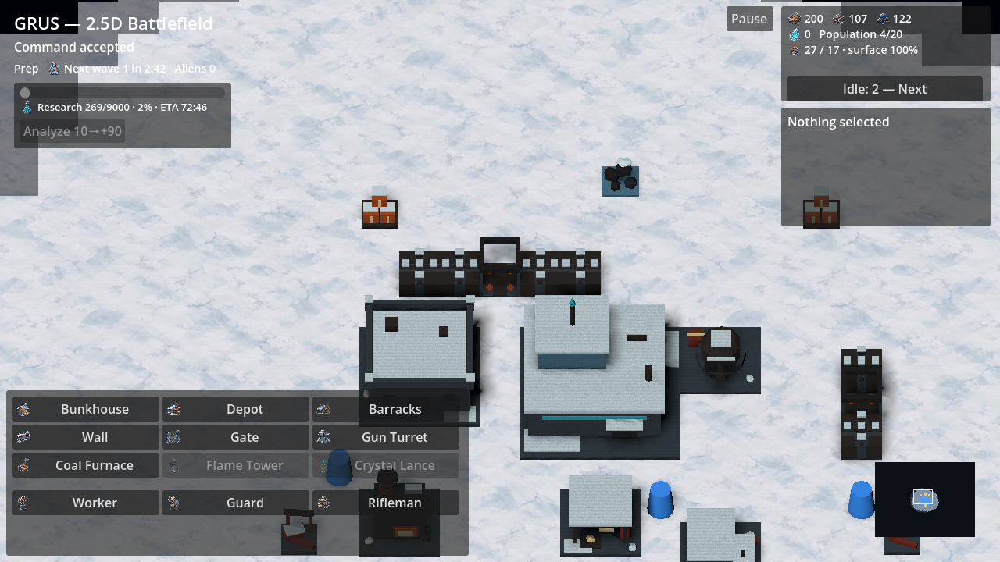
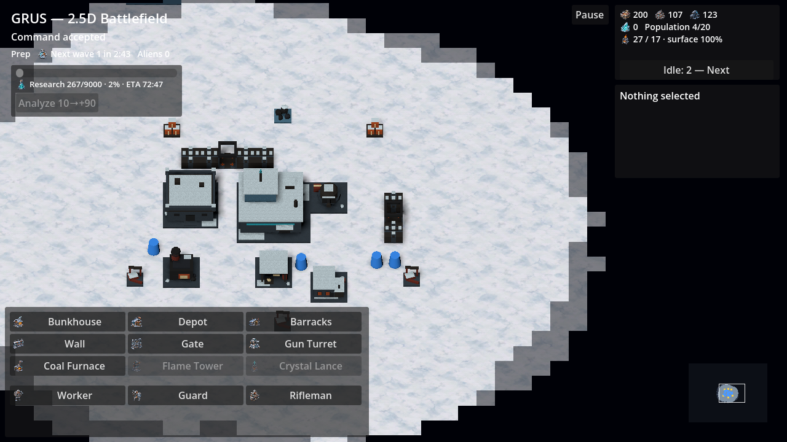
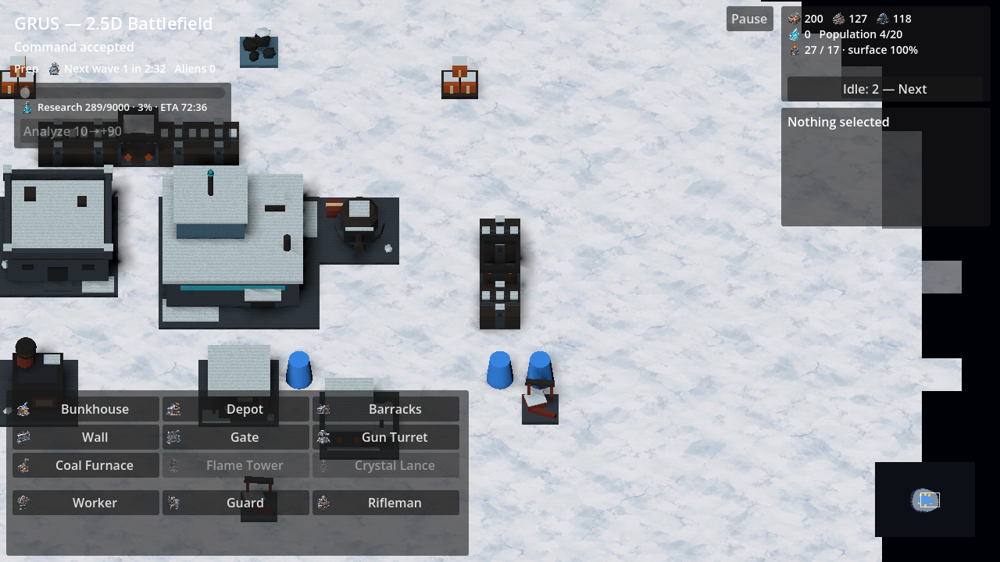
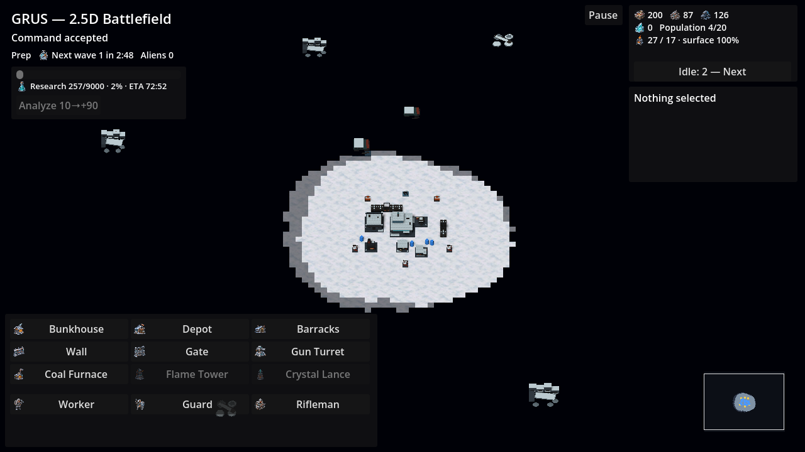
